<div align="center">

# MoToK (모톡)

**웹캠 모션 인식 기반 실시간 멀티플레이 미니게임 플랫폼**

컨트롤러도 설치도 없이, 브라우저와 웹캠만으로 최대 8명이 함께 몸으로 노는 웹 게임.

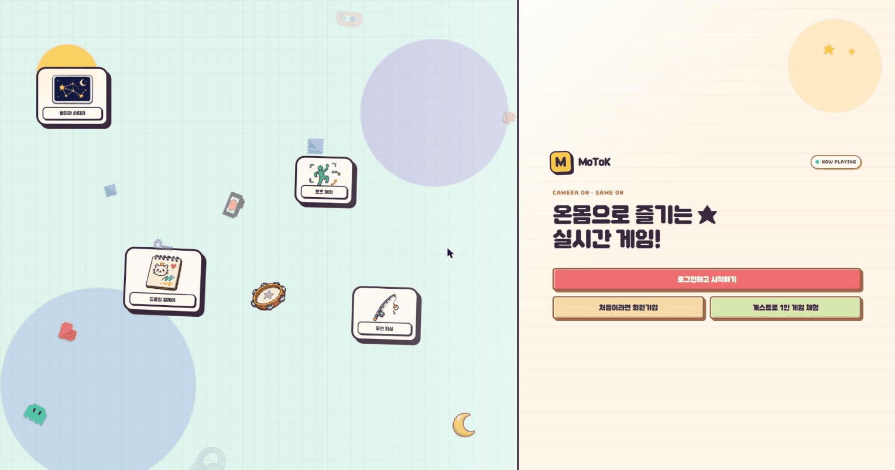

</div>

---

## 목차

- [프로젝트 개요](#프로젝트-개요)
- [주요 기능](#주요-기능)
- [게임 5종](#게임-5종)
- [화면](#화면)
- [기술 스택](#기술-스택)
- [시스템 아키텍처](#시스템-아키텍처)
- [설계 포인트](#설계-포인트)
- [프로젝트 구조](#프로젝트-구조)
- [로컬 실행](#로컬-실행)
- [상세 문서](#상세-문서)
- [팀](#팀)
- [라이선스 및 고지](#라이선스-및-고지)

---

## 프로젝트 개요

| 항목 | 내용 |
|---|---|
| 서비스명 | MoToK (모톡) / MotionTok |
| 기간 | 2026-07-15 ~ 2026-08-25 (약 6주) |
| 소속 | SSAFY 15기 자율 프로젝트 · A706 |
| 팀 구성 | 6명 (백엔드 · 프론트엔드 겸업) |
| 배포 도메인 | `motok.co.kr` — **프로젝트 종료로 서버 내려감** |
| 규모 | Java 34.6k · TypeScript 34.7k · Vue 36.8k 라인 / 커밋 1,009개 |

브라우저에서 웹캠 영상을 받아 **클라이언트에서 직접 손·자세 랜드마크를 추출**하고, 그 결과를 점수로 환산해 서버가 정산합니다. 영상 자체는 게임 판정에 쓰이지 않고 화면 공유용으로만 SFU를 거치므로, 참가자가 늘어도 서버의 추론 부하가 늘지 않습니다.

---

## 주요 기능

### 게임

- **모션 인식 플레이** — MediaPipe Tasks Vision으로 손(Hand Landmarker) · 자세(Pose Landmarker) 추적
- **실시간 멀티플레이** — 방 하나에 최대 8명, STOMP over WebSocket으로 점수·진행 상황 동기화
- **화상·음성** — LiveKit SFU 자체 호스팅. 대기실·게임 중 서로의 카메라를 봄
- **서버 정산** — 클라이언트가 보낸 진행 상황을 서버가 모아 최종 점수·포인트·랭킹을 확정

### 계정 · 소셜

- 이메일 가입(인증번호 발송) + Google · Kakao OAuth 로그인
- 친구 추가 · 온라인 상태 표시 · 친구 초대
- 대기실 채팅 · 귓속말 · 비속어 필터

### 성장 · 꾸미기

- 게임 보상 포인트 → 상점에서 가면 · 효과 · 스티커 · 배경 구매
- **AI 아바타 생성** — 직접 그린 그림을 fal.ai에 넘겨 아이템 이미지로 변환
- 전체 / 주간 랭킹, 게임별 리더보드, 개인 전적 · 포인트 내역

### 운영

- 채팅 · 사용자 신고 접수, 제재 이력 관리, 게임 on/off 제어 (관리자 전용)

---

## 게임 5종

| 게임 | 모드 | 인원 | 시간 | 사용 인식 |
|---|---|---|---|---|
| **별따라 손따라** | VERSUS | 1~8 | 60초 | 손 (Hand Landmarker) |
| **캐치캐치리듬** | VERSUS | 1~8 | 60초 | 손 (Hand Landmarker) |
| **그대로 멈춰라** | VERSUS | 1~8 | 12초/라운드 | 자세 (Pose Landmarker) + three.js |
| **그림으로 말해요** | COOP | 3~8 | 90초 | 손 + AI 채점 |
| **모션 낚시** | VERSUS | 1~8 | 90초 | 자세 · 손 제스처 |

<details>
<summary>게임별 조작 방식</summary>

| 게임 | 조작 |
|---|---|
| 별따라 손따라 | 열 손가락 끝을 움직여 화면 속 별 위에 올려놓기 |
| 캐치캐치리듬 | 판정선에 원이 겹치는 순간 손을 대기. 파랑=왼손 / 빨강=오른손 / 보라=아무 손 |
| 그대로 멈춰라 | 벽이 다가오면 구멍 모양과 같은 포즈 취하기 |
| 그림으로 말해요 | 엄지+검지를 집으면 그리기, 반대 손 주먹으로 문지르면 지우기 |
| 모션 낚시 | 양손으로 대를 쥐고 젖혔다 휘둘러 캐스팅 → 입질에 손 들어 챔질 → 한 손으로 릴 감기 |

</details>

---

## 화면

### 진입 · 게임 선택

| 게임 목록 | 로비 |
|---|---|
| 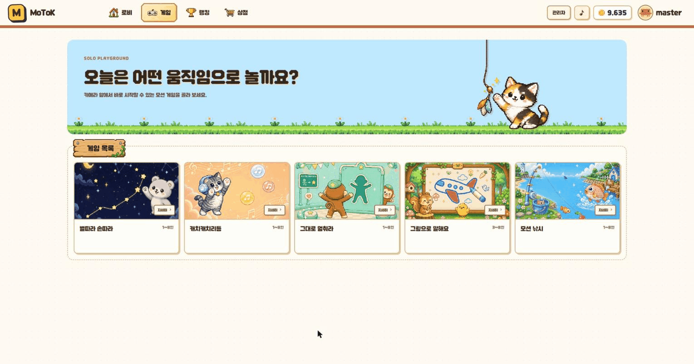 | 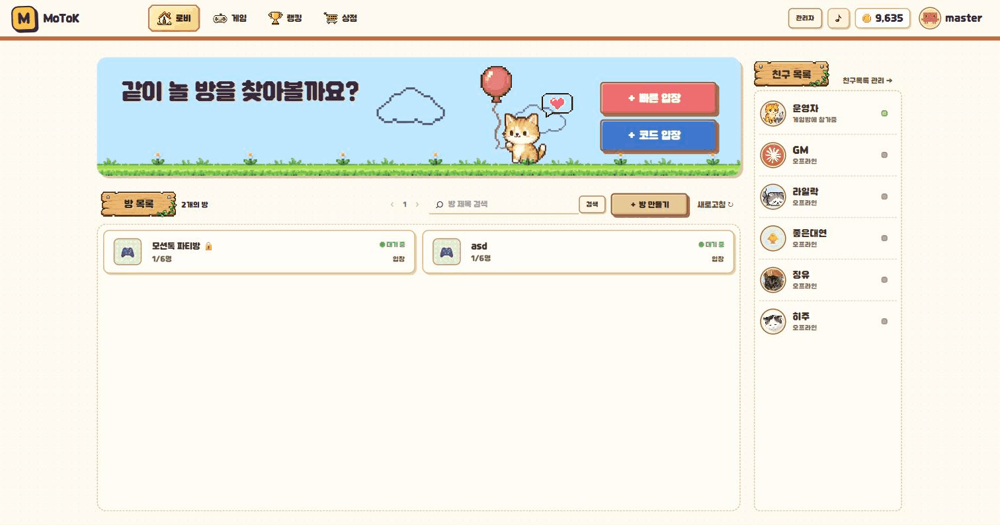 |

### 입장 · 대기실

| 기기 점검 | 대기실 |
|---|---|
| 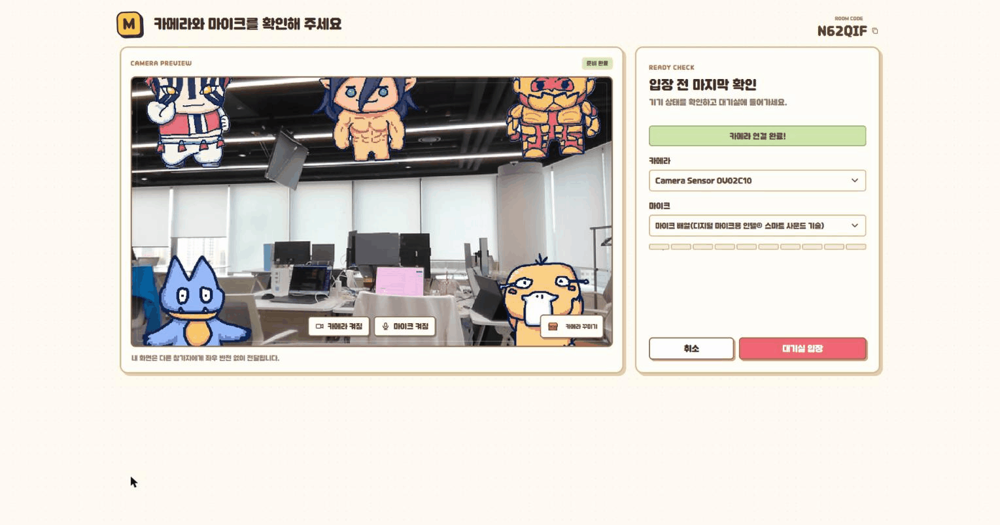 | 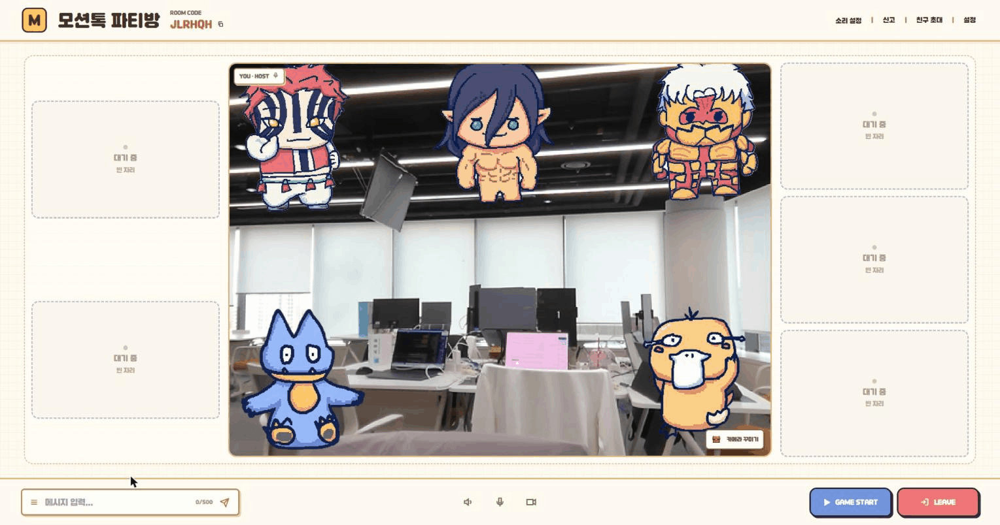 |

입장 전 카메라·마이크를 확인하고, 대기실에서는 구매한 스티커를 실시간 영상 위에 올려 꾸밀 수 있습니다.

### 게임 플레이

| 별따라 손따라 | 캐치캐치리듬 |
|---|---|
| 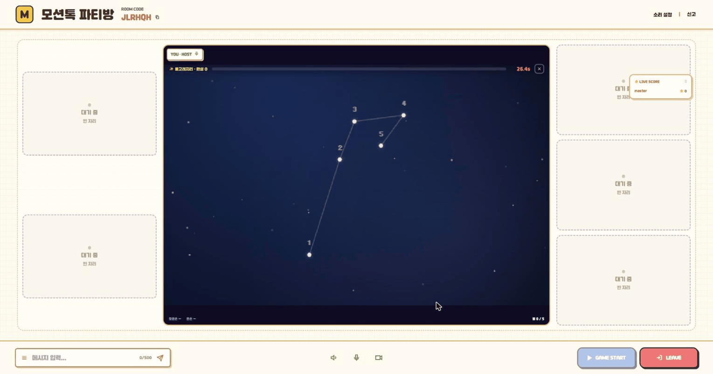 | 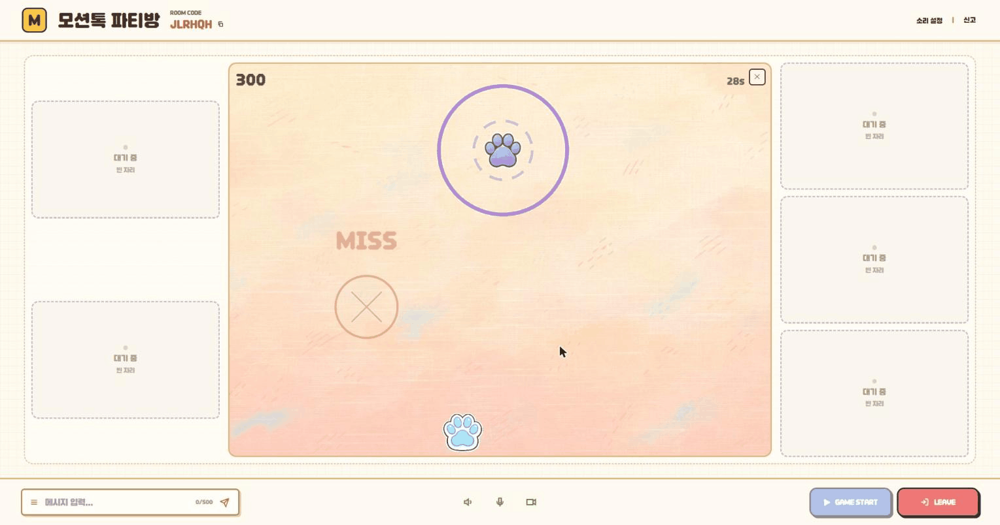 |

| 그대로 멈춰라 | 모션 낚시 |
|---|---|
| 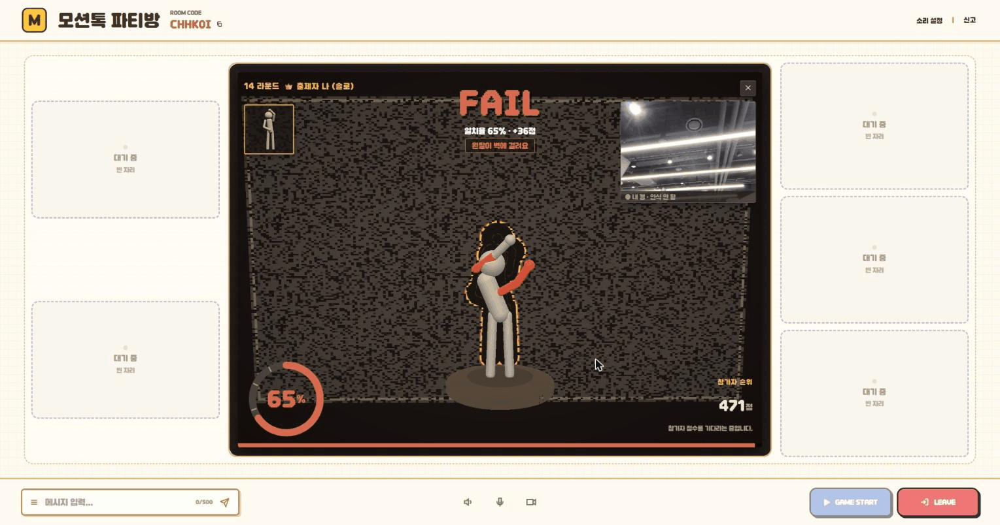 | 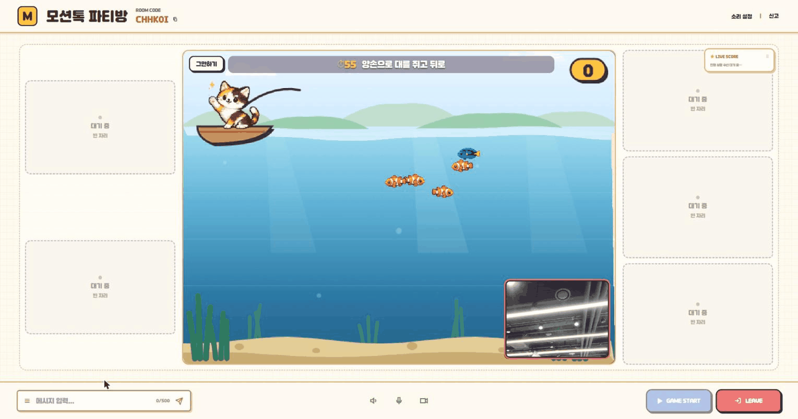 |

`그대로 멈춰라`는 Pose Landmarker로 추출한 관절 좌표를 three.js 3D 아바타에 입히고, 벽의 구멍 실루엣과 겹치는 비율을 일치율로 환산합니다.

### 결과 · 랭킹 · 꾸미기

| 게임 결과 | 랭킹 |
|---|---|
| 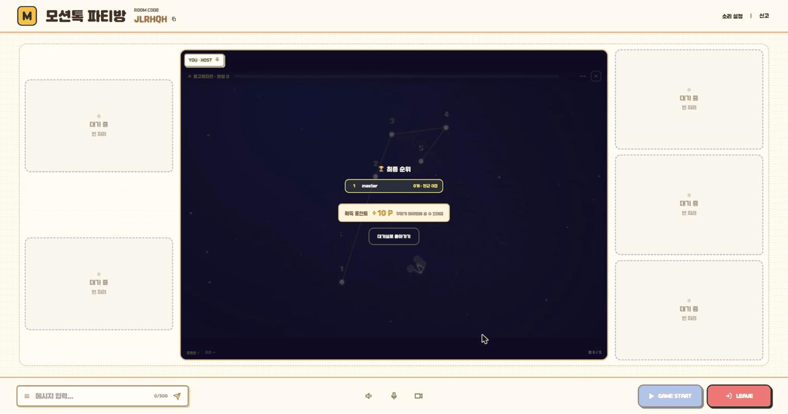 | 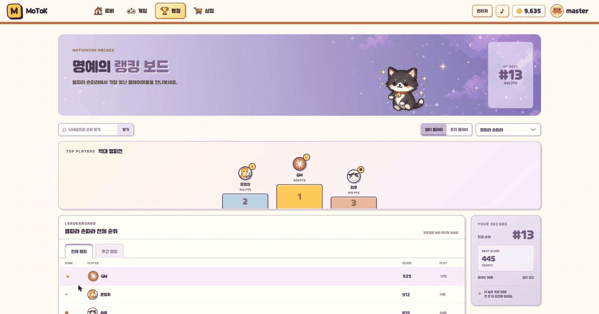 |

| 상점 | AI 아바타 만들기 |
|---|---|
| 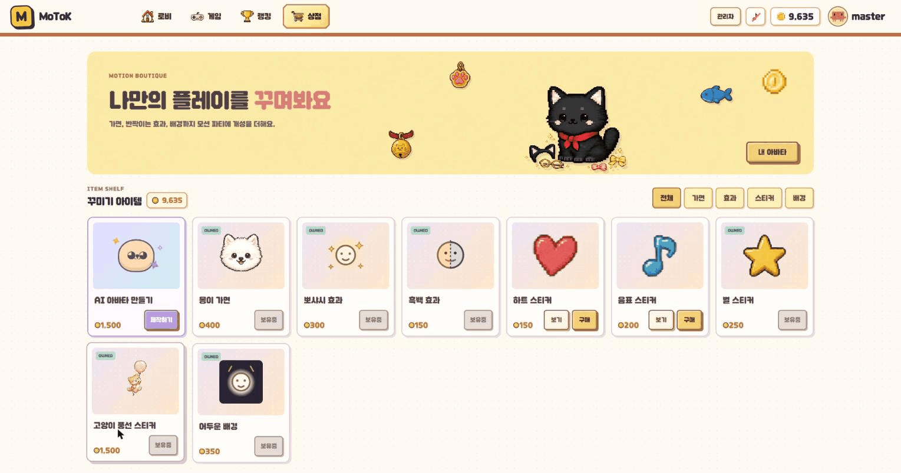 | 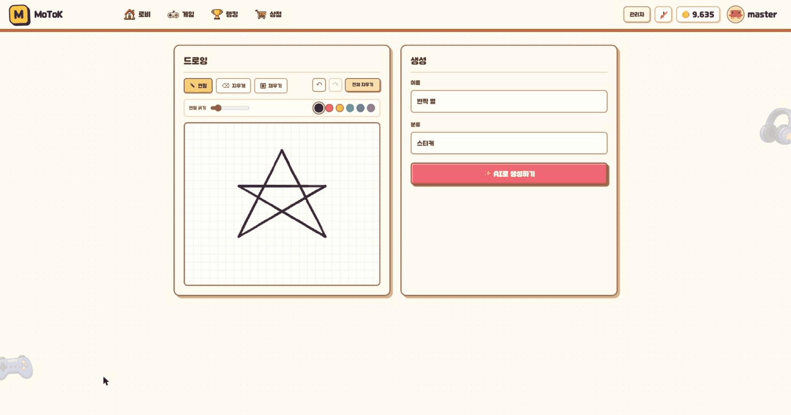 |

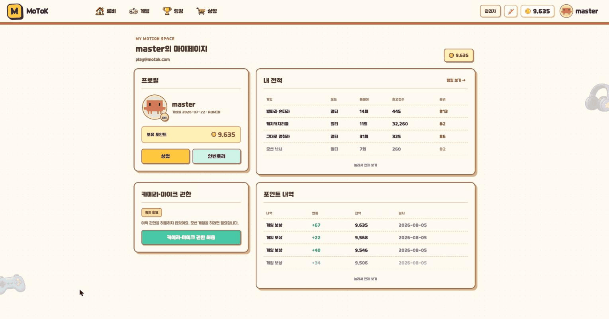

---

## 기술 스택

### Frontend

| 구분 | 기술 |
|---|---|
| 프레임워크 | Vue 3.5 (Composition API) · TypeScript 6 |
| 빌드 | Vite 8 · pnpm 11.15.1 |
| 상태 · 라우팅 | Pinia 3 · Vue Router 5 |
| 모션 인식 | `@mediapipe/tasks-vision` 0.10 (셀프 호스팅) |
| 3D | three.js 0.185 |
| 실시간 | `@stomp/stompjs` 7 · `livekit-client` 2.20 |
| 테스트 · 품질 | Vitest · oxlint · ESLint · Prettier |

### Backend

| 구분 | 기술 |
|---|---|
| 런타임 | Java 21 (Temurin) · Gradle Wrapper 9.5.1 |
| 프레임워크 | Spring Boot 4.1 · Spring Security 7.1 · Spring Data JPA / Redis |
| WAS | 내장 Tomcat 11.0 |
| 저장소 | MySQL 8.4 · Redis 7.4 (AOF) |
| 인증 | JWT (jjwt 0.12.6) · Google / Kakao OAuth |
| 미디어 | LiveKit Server v1.13.4 (SFU, 자체 호스팅) · coturn |
| 스토리지 | AWS S3 (운영) / MinIO (로컬) |
| 관측 | Actuator + Micrometer Prometheus (관리 포트 분리) |

### Infra

| 구분 | 기술 |
|---|---|
| 서버 | AWS EC2 단일 호스트 · Docker Compose |
| 웹서버 | nginx 1.27-alpine (TLS 종료 · SPA 서빙 · 리버스 프록시) |
| CI/CD | GitLab CI (shell executor Runner) |
| 인증서 | Let's Encrypt (certbot, 12시간 갱신 루프) |
| 모니터링 | node-exporter (127.0.0.1 바인딩, SSH 터널 수집) |

### 외부 서비스

Google OAuth · Kakao OAuth · fal.ai (AI 아이템 생성) · GMS(SSAFY OpenAI 릴레이, 그림 채점) · Gmail SMTP · 자체 호스팅 GPU 워커

> 외부 키는 **없으면 해당 기능만 꺼지고 앱은 정상 기동**하도록 설계했습니다. 단 `DB_*` 5종 · `JWT_SECRET` · `MAIL_*` 4종은 기본값이 없어 미설정 시 기동이 실패합니다.

---

## 시스템 아키텍처

```
                    [ 브라우저 (Chrome + 웹캠) ]
                        │                    │
             HTTPS/WSS  │                    │  UDP 50000-50100 (RTC 미디어)
                    443 │                    │  TCP 7881 (UDP 차단망 폴백)
                        ▼                    │  ※ nginx를 거치지 않고 직행
┌──────────────────────────────────────────┐ │
│  EC2 단일 호스트 · Docker Compose          │ │
│                                          │ │
│  ┌────────────────────────────────────┐  │ │
│  │ nginx 1.27                         │  │ │
│  │  · SPA 정적 서빙                    │  │ │
│  │  · /api  → app:8080                │  │ │
│  │  · /ws   → app:8080 (STOMP)        │  │ │
│  │  · /livekit/ → livekit:7880 (시그널) │  │ │
│  │  · TLS 종료 (Let's Encrypt)         │  │ │
│  └──────┬────────────────────┬────────┘  │ │
│         ▼                    ▼           │ │
│  ┌──────────────┐   ┌──────────────────┐ │ │
│  │ app          │   │ livekit-server   │◄┼─┘
│  │ Spring Boot 4│   │ v1.13.4 (SFU)    │ │   미디어 직행
│  │ :8080        │   └──────────────────┘ │
│  │ :9090 관리    │                        │
│  └───┬──────┬───┘   ┌──────────────────┐ │
│      ▼      ▼       │ certbot          │ │
│  ┌───────┐┌───────┐ │ node-exporter    │ │
│  │ mysql ││ redis │ └──────────────────┘ │
│  │  8.4  ││  7.4  │                      │
│  └───────┘└───────┘                      │
└──────────────────────────────────────────┘
       │              │              │
       ▼              ▼              ▼
   AWS S3      Gmail SMTP     fal.ai · GMS
                              GPU 워커(폴링)
```

---

## 설계 포인트

### 추론은 클라이언트, 판정은 서버

MediaPipe 모델을 **브라우저에서 실행**합니다. 서버는 랜드마크 영상을 받지 않고 점수 이벤트만 받으므로, 동시 접속자가 늘어도 GPU·CPU 추론 비용이 서버에 쌓이지 않습니다. 대신 점수 확정·포인트 지급·랭킹 반영은 전부 서버(`GameSessionService` → `GameSettlementService` → `PointCalculator`)에서 처리해 클라이언트 값을 그대로 신뢰하지 않습니다.

### MediaPipe 모델 셀프 호스팅

`public/mediapipe/`에 약 55MB의 모델·wasm을 직접 담았습니다. CDN을 쓰면 사내망 차단·CDN 장애가 곧 서비스 장애가 되고, 버전이 말없이 바뀔 수 있습니다. 로비 진입 시 필요한 모델(손 7.8MB + 자세 9.4MB)만 스플래시로 내려받습니다.

### Redis는 캐시가 아니라 저장소

방·게임 세션·리프레시 토큰이 Redis에 있습니다. 재시작으로 날아가면 진행 중인 게임이 사라지므로,

- `appendonly yes` (AOF 켜기)
- `maxmemory-policy noeviction` — **LRU 계열 금지**. 조용히 지워지면 방이 사라집니다
- `maxmemory 512mb` — 정책이 noeviction이어도 상한은 필요 (없으면 OOM)

### 관리 포트 분리 (9090)

Tomcat 스레드가 전부 잠기면 같은 포트의 Actuator도 응답하지 못합니다. "죽는 순간의 지표"를 잃지 않으려고 관리 포트를 8080에서 떼어 `127.0.0.1`에만 바인딩했습니다. 노출 엔드포인트는 `health`, `prometheus` 둘뿐 — `heapdump`는 호출 한 번으로 서버를 멈추고 `env`는 시크릿을 통째로 뱉습니다.

### keep-alive 타임아웃 짝 맞추기

nginx upstream `keepalive_timeout 30s`에 대해 Tomcat `keep-alive-timeout`을 **120s**로 더 길게 잡았습니다. Tomcat이 먼저 끊으면 nginx가 이미 닫힌 커넥션에 요청을 실어 보내 재현 안 되는 간헐 502가 납니다. 항상 nginx가 먼저 닫도록 순서를 고정한 것이고, **한쪽만 바꾸면 안 됩니다.**

### UDP 차단망 폴백

LiveKit 미디어는 UDP 50000-50100을 씁니다. UDP가 막힌 사내망을 대비해 TCP 7881 폴백과 자체 호스팅 coturn(TURN 릴레이)을 함께 두었습니다.

---

## 프로젝트 구조

```
.
├── MotionTok/
│   ├── Backend/              # Spring Boot 4
│   │   ├── src/main/java/ssafy/a706/backend/
│   │   │   ├── auth/         # JWT · OAuth · 이메일 인증 · 비밀번호 재설정
│   │   │   ├── game/         # 세션 · 정산 · 리더보드 · 그림 AI 채점
│   │   │   ├── liveroom/     # 방 생성/입장/호스트 위임 · 로비 브로드캐스트
│   │   │   ├── video/        # LiveKit 토큰 발급 · 룸 제어
│   │   │   ├── shop/ decor/  # 상점 · 인벤토리 · 꾸미기 · AI 아이템 생성
│   │   │   ├── user/ friend/ presence/   # 프로필 · 친구 · 온라인 상태
│   │   │   ├── chat/ whisper/ profanity/ # 채팅 · 귓속말 · 비속어 필터
│   │   │   ├── report/       # 신고 · 제재
│   │   │   └── global/       # 공통 설정 · 예외 · 응답 포맷
│   │   ├── livekit/          # LiveKit 서버 설정
│   │   ├── nginx/            # 운영 nginx 설정
│   │   └── docker-compose*.yml
│   ├── Frontend/             # Vue 3 + Vite
│   │   ├── src/features/     # lobby · game-room · games · ranking · shop · admin ...
│   │   ├── src/stores/       # Pinia
│   │   └── public/mediapipe/ # 셀프 호스팅 모델 (~55MB)
│   └── docs/                 # API 명세 · ERD · Redis 키맵 · 작업 인계 문서
├── exec/                     # 포팅 매뉴얼 · 시연 시나리오 · 외부 서비스 정보 · DB 덤프
├── docs/screenshots/         # README 스크린샷
└── NOTICE.md                 # 서드파티 자산 고지
```

---

## 로컬 실행

### 사전 준비

| 항목 | 버전 |
|---|---|
| Docker Desktop (Compose v2) | `docker compose` 사용 가능 버전 |
| JDK | 21 |
| Node.js | 22.18.0+ 또는 24.12.0+ |
| pnpm | 11.15.1 (corepack) |

Gradle은 Wrapper가 있어 설치 불필요합니다. 웹캠이 달린 데스크톱 + 최신 Chrome이 필요합니다.

> `http://127.0.0.1:5173`이 아니라 반드시 **`http://localhost:5173`** 으로 접속하세요. 브라우저가 `localhost`만 보안 컨텍스트로 인정해서, IP로 접속하면 `getUserMedia`가 막혀 카메라가 아예 켜지지 않습니다.

### 1. 환경 변수

`MotionTok/Backend/.env`와 `MotionTok/Frontend/.env`는 `.gitignore` 대상이라 직접 만들어야 합니다. 최소 구성 예시와 전체 변수 표는 [`exec/포팅매뉴얼.md`](exec/포팅매뉴얼.md) §3~4에 있습니다.

### 2. 인프라 컨테이너

```bash
cd MotionTok/Backend
docker compose up -d
```

| 서비스 | 호스트 포트 | 비고 |
|---|---|---|
| MySQL 8.4 | 3307 | 호스트 MySQL과 충돌을 피해 3307로 매핑 |
| Redis 7.4 | 6379 | AOF 켜짐 |
| LiveKit | 7880 / 7881 / 7882udp | 화상 개발 시에만 필요 |
| MinIO | 9000 (API) / 9001 (콘솔) | S3 대체 |

### 3. 백엔드

```bash
cd MotionTok/Backend && ./gradlew bootRun
```

확인: `curl http://localhost:9090/actuator/health` → `{"status":"UP"}`

### 4. 프론트엔드

```bash
cd MotionTok/Frontend && corepack enable && pnpm install && pnpm dev
```

브라우저에서 `http://localhost:5173` 접속 → `게스트로 1인 게임 체험`으로 로그인 없이 확인할 수 있습니다.

---

## 상세 문서

| 문서 | 내용 |
|---|---|
| [`exec/포팅매뉴얼.md`](exec/포팅매뉴얼.md) | 빌드 · 로컬 실행 · 배포 · 트러블슈팅 전 과정 |
| [`exec/외부서비스정보.md`](exec/외부서비스정보.md) | 외부 서비스 13종 발급 절차 · 요금 · 환경변수 |
| [`exec/배포환경변수.md`](exec/배포환경변수.md) | 배포 환경변수 키 목록 |
| [`exec/시연시나리오.md`](exec/시연시나리오.md) | 시연 대본 · 게임 규칙 · 라우트 전체 표 |
| [`MotionTok/docs/`](MotionTok/docs/) | API 명세서 · ERD · Redis 키맵 |

---

## 팀

SSAFY 15기 A706 · 6명 — 강유진 · 김성령 · 심재현 · 이상민 · 임대연 · 조희주

저장소에 역할 분담 문서가 없어 담당 영역은 명시하지 않았습니다. 커밋 이력상 주요 기여자는 백엔드와 프론트엔드를 모두 작업했습니다.

---

## 라이선스 및 고지

- 이 저장소는 SSAFY 교육 과정의 팀 프로젝트 결과물입니다. 별도 오픈소스 라이선스를 적용하지 않았습니다.
- 포함된 서드파티 자산(폰트 등)의 저작권 고지는 [`NOTICE.md`](NOTICE.md)를 참고하세요.
- 원본 저장소는 SSAFY GitLab(`lab.ssafy.com`)이며, 이 GitHub 저장소는 공개용 사본입니다. 커밋 작성자 이메일은 팀원 개인정보 보호를 위해 비식별 주소로 치환했습니다.
